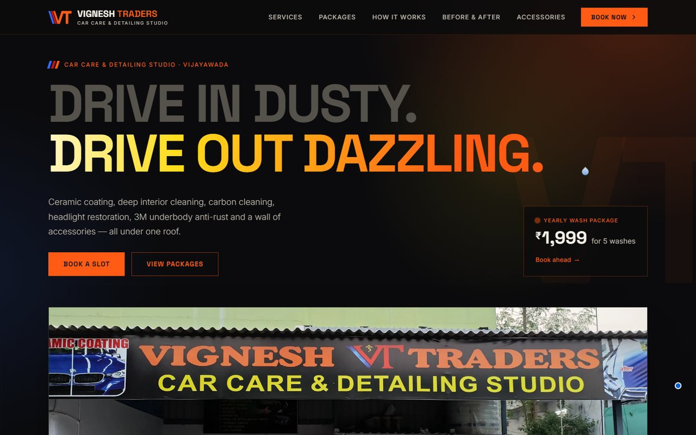
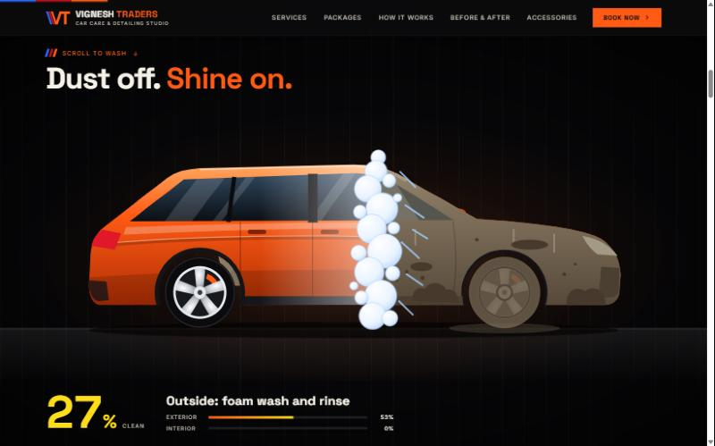
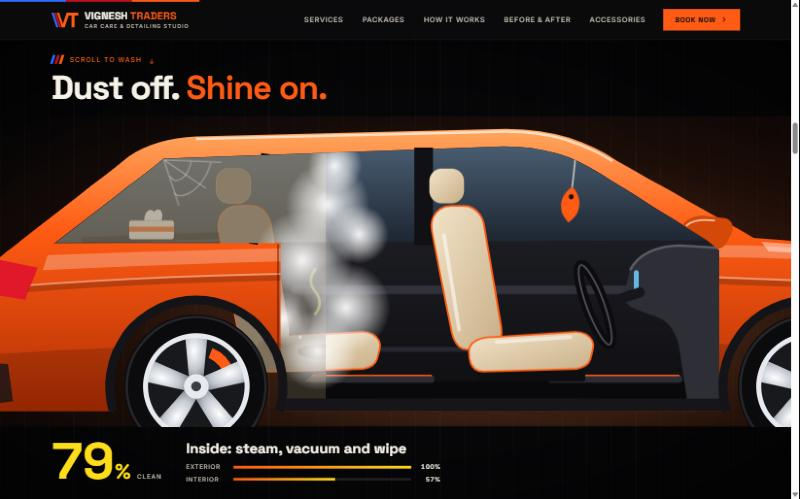

# Vignesh Traders — Car Care & Detailing Studio

Website for a car care and detailing studio in Vijayawada, India: services, fixed-price packages, before/after proof and a booking form that hands off to WhatsApp.

**Live:** https://vignesh-traders.vercel.app



## Scroll to wash

The centrepiece is a car drawn entirely in SVG that gets cleaned as you scroll. It rolls in covered in dust, a foam bar washes the outside, the doors turn see-through while the camera moves into the cabin, steam cleans the seats and dashboard, and the car drives off with its headlights on.

| Outside | Inside |
| --- | --- |
|  |  |

Scroll position drives every part of the drawing, so it runs forwards and backwards with the page and never on a timer. The car is drawn twice, clean underneath and dusty on top, and two clip rectangles slide across to uncover the clean version.

## What else is on the page

- Hero photo of the real storefront that wipes from dull grey to full colour on load
- Eight service cards and three priced packages, with a medium/large car price toggle
- Drag slider comparing an underbody before and after anti-rust coating
- Booking form that opens WhatsApp with the message already written (no backend, and no pop-up for the browser to block)
- Twelve accessory categories and a photo gallery with a lightbox
- On phones: a swipe rail for accessories and a fixed Call / WhatsApp bar

Every price, service and warranty on the page was read off the studio's own signboards.

## Built with

- HTML, CSS and vanilla JavaScript. No framework, no build step, no dependencies.
- Inline SVG for the car scene, with `requestAnimationFrame` mapping scroll to the drawing
- `IntersectionObserver` for scroll reveals and count-ups
- Phone photos of the signboards, cropped and perspective-corrected with OpenCV and Pillow
- Deployed on Vercel

The page still works with JavaScript off, and with reduced motion turned on the car simply sits there clean.

## Run locally

```bash
python -m http.server 5210
```

Then open http://localhost:5210.

## Where things are

| Path | What it holds |
| --- | --- |
| `index.html` | All page content and the SVG car scene |
| `css/styles.css` | Styles; colour tokens are at the top |
| `js/main.js` | Interactions; shop details (address, hours, map link) sit in the `SITE` block at the top |
| `assets/img/` | Photos and crops, as WebP |
